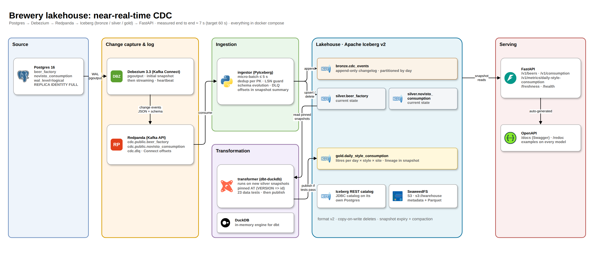

# Design: Nikita Starkov

## 1. Architecture

Debezium reads the Postgres WAL (snapshot, then streaming) into one keyed Redpanda topic per table. The
**ingestor** micro-batches them into Iceberg: every event is appended to `bronze.cdc_events`, the latest
change per key is applied to `silver.<table>` (current state). On every new silver snapshot the
**transformer** runs dbt pinned to those snapshots, tests the result, and only then publishes
`gold.daily_style_consumption`. **FastAPI** reads silver and gold through the Iceberg REST catalog; files
live on S3 (SeaweedFS).

## 2. Stack choices

| Layer | Choice | Why | Considered / rejected |
|---|---|---|---|
| CDC | Debezium 3.3 (Kafka Connect) | standard; snapshot + streaming, full before/after images | Flink CDC: heavier; schema change = job redeploy |
| Log | Redpanda | Kafka API, one binary, ~200 MB; replay + decoupling | Kafka: more memory; Debezium Server → sink: no replay |
| Sink | Python + PyIceberg 0.12 | full control of semantics (dedup, LSN guard, offsets in snapshot); `union_by_name` schema evolution; ~120 MB | Flink/Spark: 2–3 GB, and equality-delete upserts are poorly read by DuckDB/PyIceberg |
| Format | Iceberg v2, copy-on-write | every reader handles it | merge-on-read: cheaper writes at scale, needs compaction |
| Catalog | Iceberg REST fixture, Postgres JDBC backend | standard protocol: DuckDB/Spark/Trino attach | sqlite backend: `SQLITE_BUSY` under concurrent commits |
| Storage | SeaweedFS (S3) | one container, creates the bucket, Apache-2.0 | local disk: hides the S3 path |
| Transform | dbt 1.12 + dbt-duckdb (DuckDB 2.0) | SQL + tests, Iceberg time travel, ~1 s builds | Spark/Trino: overkill in memory |
| API | FastAPI + Pydantic v2 | typed models → OpenAPI with examples | GraphQL: no client needs it |

## 3. CDC semantics

- **Representation.** Bronze is an append-only changelog (`op`, before/after JSON, `lsn`, `tx_id`,
  source and ingest timestamps), partitioned by day. Silver is current state: in one Iceberg transaction
  per table, the rows whose keys changed are deleted (copy-on-write) and their new versions appended. A
  key inserted and deleted within a batch produces nothing. Hard deletes remove the row. Every silver row
  carries `_op`, `_lsn`, `_source_ts` and `_ingested_at`.
- **Delivery.** Debezium → Kafka is at-least-once. The sink gives an **exactly-once effect** without a
  two-phase commit:
  - The Kafka offsets a table has applied are written into the **summary of the same snapshot** as its
    data, so data and progress commit atomically.
  - Each table skips events with `offset ≤` its own committed offset.
  - Within a batch, the highest `(lsn, offset)` wins per PK.
  - An **LSN guard** never lets an older change overwrite a newer row. This also absorbs Debezium
    re-deliveries, which arrive under new Kafka offsets but with the same LSN.
  - Kafka consumer-group commits are only for lag monitoring.
- **Ordering.** Topics are keyed by PK, so per-key order is preserved.
- **Bad messages.** They go to `cdc.dlq` with error headers instead of blocking the stream.
- **Restarts** (tested: `kill -9` mid-batch, Debezium restart, deleted consumer group = full replay,
  ingestor offline during 60 changes, `make down/up`): the ingestor seeks to the slowest table's committed
  offset; counts and sums always matched Postgres. The transformer keeps its input snapshot ids as lineage
  in the gold snapshot, so it never republishes the same input or skips a change.

## 4. Freshness vs. cost

- **Commit interval.** The ingestor flushes every **5 s or 5 000 events**, one commit per table per
  batch. This is the knob (`FLUSH_INTERVAL_S`) that trades freshness for files and snapshots. The
  transformer polls snapshot ids every 5 s and builds only when they changed. The API checks for a new
  snapshot at most once per second and caches Arrow data per snapshot id.
- **Small files and metadata.** Copy-on-write rewrites only the files that contain changed keys. Every
  5 minutes the ingestor compacts a table once it has 20 or more data files (a full rewrite, allowed only
  for tables under 1 M rows) and expires snapshots older than 1 h. `metadata.json` history is capped at 20
  files. Orphan files are not deleted: PyIceberg has no `remove_orphan_files`.
- **Measured latency.** Postgres commit to silver in **2–5 s**, to gold in **6–7 s**, everything
  visible in the API after **4.9–7.1 s** (`make demo`, several runs). A 60 s burst of continuous
  inserts, updates and deletes produced no commit conflicts and no restarts; afterwards counts and gold
  totals matched Postgres exactly. The stack uses about 2.1 GB RAM.

## 5. Transformation layer

- **Model.** `fct_daily_style_consumption`: one row per UTC day × beer style × factory site, with
  litres, pure-alcohol litres, events, distinct beers and teams. It answers the brief ("litres per style
  per day, joined with factory data"). It uses a left join, so consumption of a beer not yet seen in
  `beer_factory` (the two tables are separate streams) is reported as `Unknown`, not dropped.
- **Staging.** Staging models select columns explicitly, so a new source column such as `ibu` does not
  leak into the mart.
- **Tests (write-audit-publish).** Blocking: PK `unique`/`not_null`, `non_negative`, uniqueness of the
  mart grain, and a reconciliation test (litres and events in the mart = staging). Warnings only:
  `accepted_values` and the FK `relationships` test.
- **Publish.** Gold is published only when all blocking tests pass, as one atomic `overwrite`. A failure
  keeps the last good mart in the API.
- **Refresh.** Full refresh on every new input (≈130 rows, about 1 s). At volume I would make it
  incremental: read the changed keys since the last published snapshot from bronze (or an Iceberg
  incremental scan), recompute only the affected days, and replace those partitions.

## 6. Known limitations

- **Schema.** `ADD COLUMN` and Iceberg-legal widening work live. An incompatible type change (e.g.
  `text → int`, a different decimal scale) stops the ingestor loudly until it is migrated by hand. A
  dropped column stays in Iceberg and is `NULL` for new rows. A rename looks like a new column. New
  tables need the connector's `table.include.list` updated. `TRUNCATE` is ignored.
- **Scale.** There is one ingestor and single-partition topics. Offsets are tracked per topic-partition,
  so adding partitions works, but silver commits from several writers would contend. The API
  materialises each snapshot in memory, which is fine for kilobytes; for big tables it should push
  filters into the scan. Gold is a full refresh. Large backfills should use Debezium incremental
  snapshots.
- **Bronze dedup.** Bronze dedups by Kafka offset, so an event Debezium re-delivers appears twice in
  bronze. Silver is unaffected thanks to the LSN guard.
- **Not hardened:** plaintext credentials, superuser replication, no TLS, test-fixture catalog.

## 7. Path to production

- **Catalog and access.** A real catalog (Lakekeeper, Polaris or Nessie) with RBAC, vended credentials
  and a namespace per source or tenant. Row/column policies enforced in the catalog, not in the API.
- **Data contracts.** Avro or Protobuf with a schema registry and compatibility rules at the Debezium
  edge, so incompatible changes are rejected before they reach the lake. dbt model contracts and
  versions for gold.
- **Ingestion at scale.** More partitions and a single writer per table, or the Kafka Connect / Flink
  Iceberg sinks with merge-on-read. Scheduled compaction and orphan cleanup (Spark/Trino procedures or
  catalog-managed maintenance).
- **Orchestration.** Streaming services on Kubernetes (Strimzi/Redpanda operator). Batch dbt and
  maintenance in Dagster or Airflow with asset-level freshness SLOs.
- **Observability.** Prometheus metrics for consumer lag, commit latency, DLQ rate and `/freshness`
  per table, with alerts on SLO breach. OpenLineage from dbt and the ingestor.
- **Security and CI/CD.** TLS, least-privilege replication role, vault secrets; CI runs tests,
  `dbt build --select state:modified+` and this compose end-to-end demo.
